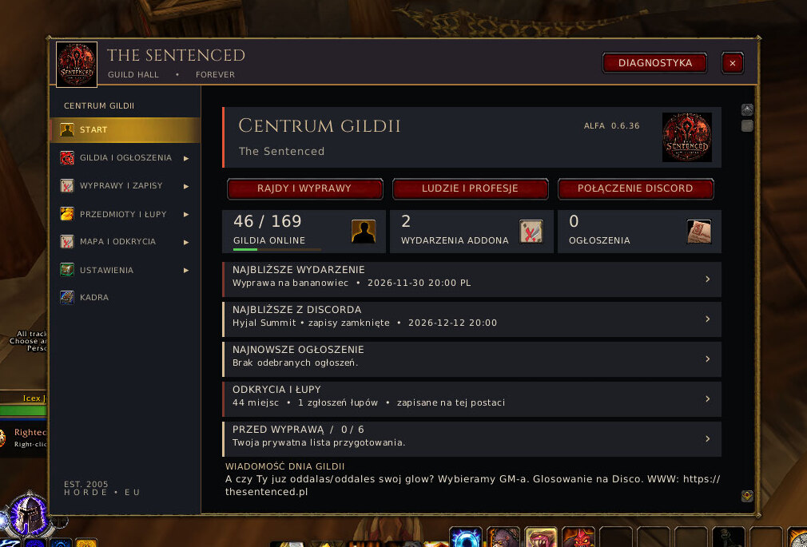

# The Sentenced

Guild Hall to centrum gildii The Sentenced w **World of Warcraft: Forever**. Otwórz je przez `/ts` albo ikonę minimapy. Znajdziesz tam wyprawy, ogłoszenia, skład i profesje gildii, dziennik łupów, mapę zbieractwa oraz Węża Hordy.

## Pobieranie i pomoc

- [Wydania ZIP na GitHubie](https://github.com/damianx9x/The-Sentenced/releases)
- [Guild Hall na CurseForge](https://www.curseforge.com/wow/addons/ts-guild-hall)
- [Strona The Sentenced](https://thesentenced.pl/)
- [Instrukcja dodatku i połączenia z Discordem](addon/README.md)
- [Jak współtworzyć projekt](CONTRIBUTING.md)

Gracze WoW Forever 1.60.1 mogą wypakować wydanie ZIP do `Interface/AddOns`. Po instalacji katalog powinien mieć ścieżkę `Interface/AddOns/TheSentenced`.

## Jak działa Guild Hall

- **Gildia** obejmuje listę członków, profile i katalog profesji. Publiczną notatkę z własnymi profesjami można przygotować w dodatku.
- **Wyprawy i tablica** mają formularze w grze, odnośniki do przedmiotów, listę przygotowania i opcje zarządzania własnymi wpisami.
- **Łupy i mapa** obejmują prywatny dziennik zielonych i lepszych łupów, własną listę życzeń oraz znaczniki zasobów.
- **Discord** obsługuje parowanie postaci z kontem, odczyt wybranych wydarzeń i zapisy na rajdy. W panelu **Kadra** GM i oficerowie mogą przeglądać wnioski, rozpatrywać je i przygotowywać wpisy do wybranych kanałów Discorda. Dostęp weryfikuje bot.

Kod dodatku jest w [addon/TheSentenced](addon/TheSentenced), a testy w [addon/tests](addon/tests). Pliki Lua wymienione w `TheSentenced.toc` ładują się w kolejności z manifestu. W grze działa osobny moduł ustawień i diagnostyki.

[Zobacz formularz wyprawy](docs/screenshots/event-form.jpg)

## English

**The Sentenced Guild Hall** brings guild rosters, professions, outing forms, loot history, gathering markers and a flight-friendly Snake minigame to WoW Forever. Install the release in `Interface/AddOns` and open it with `/ts`. Guild features use the in-game roster and supported addons. Discord-linked operations require a linked character and current server permissions. See the [contribution guide](CONTRIBUTING.md) to start changing or testing the addon.
