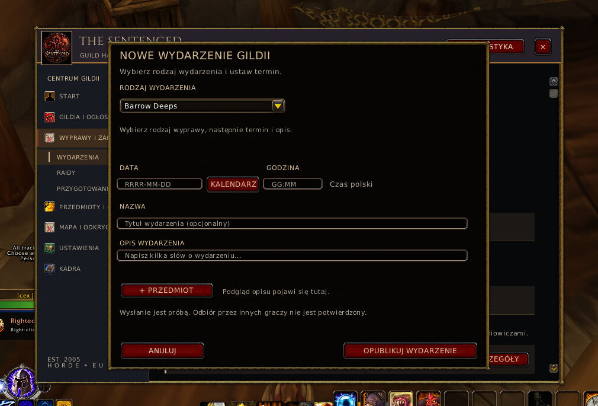

# The Sentenced

Guild Hall to centrum gildii The Sentenced w **World of Warcraft: Forever**. Otwórz je przez `/ts` albo ikonę minimapy. Znajdziesz tam wyprawy, ogłoszenia, skład i profesje gildii, dziennik łupów, mapę zbieractwa oraz Węża Hordy.


## Pobieranie i pomoc

- [Wydania ZIP na GitHubie](https://github.com/damianx9x/The-Sentenced/releases)
- [Guild Hall na CurseForge](https://www.curseforge.com/wow/addons/ts-guild-hall)
- [Strona The Sentenced](https://thesentenced.pl/)
- [Instrukcja dodatku i połączenia z Discordem](addon/README.md)
- [Jak współtworzyć projekt](CONTRIBUTING.md)

Gracze WoW Forever 1.60.1 mogą wypakować wydanie ZIP do `Interface/AddOns`. Po instalacji katalog powinien mieć ścieżkę `Interface/AddOns/TheSentenced`.

## Monorepo — co tu jest

| Część | Katalog | Dokumentacja |
|---|---|---|
| Dodatek WoW Guild Hall | `addon/` | [docs/05-addon.md](docs/05-addon.md) |
| Bot Discord SentencedBot | `runtime/` | [docs/03-bot.md](docs/03-bot.md) |
| Serwer Discord (kanały, role, uprawnienia) | — | [docs/02-discord.md](docs/02-discord.md) |
| Raspberry Pi, tunel, wdrożenie | — | [docs/04-infrastruktura-raspberry.md](docs/04-infrastruktura-raspberry.md) |
| Most Mac ↔ bot | `mac/` | [docs/01-architektura.md](docs/01-architektura.md) |
| Testy | `tests/`, `addon/tests/` | `make test` |

Zacznij od [docs/README.md](docs/README.md). Agenci AI (Codex, Claude, Cursor): [AGENTS.md](AGENTS.md).

```sh
make setup && make test
```

## Jak działa Guild Hall

- **Gildia** obejmuje listę członków, profile i katalog profesji. Publiczną notatkę z własnymi profesjami można przygotować w dodatku.
- **Wyprawy i tabela** mają formularze w grze, odnośniki do przedmiotów, listę przygotowania i opcje zarządzania własnymi wpisami.
- **Łupy i mapa** obejmują prywatny dziennik zielonych i lepszych łupów, własną listę życzeń oraz znaczniki zasobów.
- **Discord** obsługuje parowanie postaci z kontem, odczyt wybranych wydarzeń i zapisy na rajdy. W panelu **Kadra** GM i oficerowie mogą przeglądać wnioski, rozpatrywać je i przygotowywać wpisy do wybranych kanałów Discorda. Dostęp weryfikuje bot.



## English

**The Sentenced Guild Hall** brings guild rosters, professions, outing forms, loot history, gathering markers and a flight-friendly Snake minigame to WoW Forever. Install the release in `Interface/AddOns` and open it with `/ts`. This repository is a monorepo: WoW addon (`addon/`), Discord bot (`runtime/`), Mac bridge (`mac/`) and full operational docs (`docs/`). AI agents start at [AGENTS.md](AGENTS.md). See the [contribution guide](CONTRIBUTING.md).
